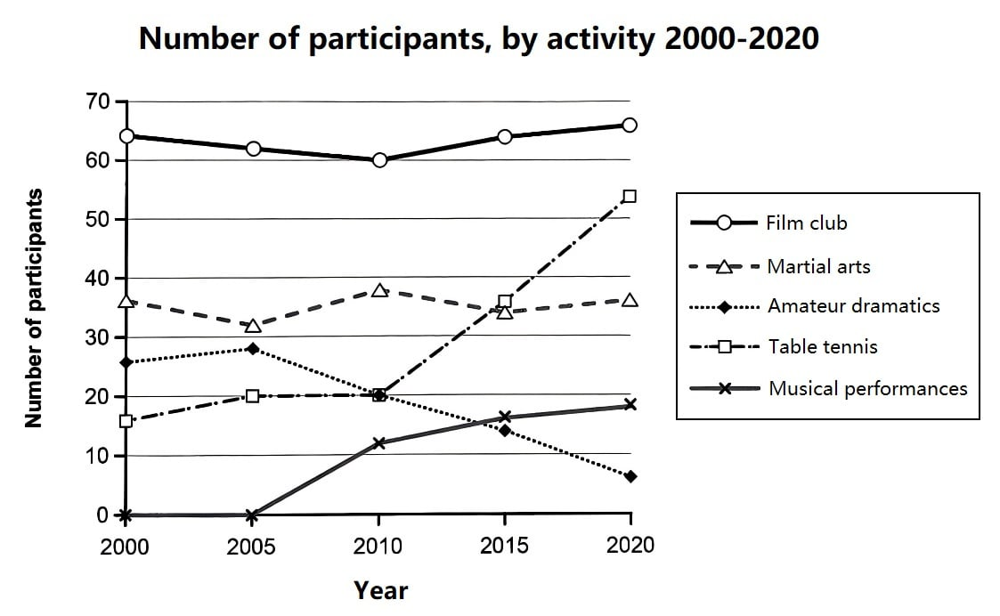

# 五项活动的参与人数变化｜Presentation 练习

- 更新日期：2026-10-29
- 题目：[C19-Test1-Task1](../C19-Test1-Task1.md)
- 写作参考：[Essay V02](../essays/C19-Test1-Task1-Essay-V02.md)
- 身份说明：以下为 ChatGPT 根据初稿与图表整理的演讲示范，不作为用户独立完成的稿件。
- 练习目标：采用直接、清晰的 presentation 风格，面对观众介绍图表、展开比较并总结。使用自然口语，不套用 IELTS 作文的字数限制。

## 1. Full presentation｜完整英文讲稿

方括号内为动作提示，不朗读。小标题用于练习定位，也不用读出来。

### A. Introduction｜问候、介绍主题

Hello, everyone. My name is Wang Haohao, and you can call me Roy.

Today, I'd like to talk about participation in five activities at a social centre in Melbourne, Australia, from 2000 to 2020.

[指向坐标轴和图例。]

Let's look at the graph. As you can see, the horizontal axis shows the years, and the vertical axis shows the number of participants. The five lines represent the film club, martial arts, amateur dramatics, table tennis, and musical performances.

Okay, I'll start with the activities that remained relatively stable, then look at those that changed more noticeably.

### B. Film club and martial arts｜先讲较稳定的两项

[指向电影俱乐部，再指向武术。]

First, let's look at the film club, shown by the top line.

It had around 65 participants in 2000. The number fell slightly to 60 in 2010, before rising to about 66 in 2020. Despite these small changes, it remained the most popular activity throughout the period.

Now, let's turn to martial arts. It showed several small rises and falls. Participation stayed between roughly 32 and 38, ending close to its starting level.

So, although the film club attracted more people than martial arts, both activities showed little overall change. Let's now move on to the two activities that gained participants: table tennis and musical performances.

### C. Table tennis and musical performances｜再讲增长的两项

[指向乒乓球。]

Of these two, table tennis had the larger increase—in fact, the largest of all five activities.

Participation rose from around 16 in 2000 to 20 in 2005, then stayed at that level until 2010. After that, it increased sharply, reaching about 54 by 2020.

By 2015, table tennis had overtaken martial arts to become the second most popular activity.

[指向音乐表演。]

Musical performances also gained participants. There were none recorded in 2000 or 2005, but the number rose to about 12 in 2010 and 18 in 2020. The overall increase was smaller than that of table tennis.

### D. Amateur dramatics｜最后讲下降的一项

[指向业余戏剧。]

In contrast to these two activities, amateur dramatics showed an overall decline—the only one to do so.

It started with around 26 participants and rose slightly to 28 in 2005. The number then fell steadily, reaching just 6 by 2020—the lowest figure among the five activities.

### E. Summary｜总结并致谢

To sum up, the film club remained the most popular activity, while table tennis showed the greatest growth.

That brings me to the end of my presentation. Thank you for listening.

## 2. 这次的调整思路

- **开门见山。** 用问候、自我介绍和主题说明开始，接着简短解释坐标轴，让听众知道该看什么。
- **给出讲述顺序。** 先稳定、再增长、最后下降。正文各部分按这一顺序展开，听众更容易跟上。
- **保留自然的引导语。** 使用 Okay、Now, let's turn to、In contrast 和 To sum up，帮助听众判断内容进行到哪里；不用刻意在每句前加连接词。
- **把比较放进说明中。** 例如电影比武术人数更多，但整体都稳定；乒乓球增长多于音乐；戏剧与增长活动方向相反。既有数据，也有关系。
- **把趋势总结分散到过渡处。** 稳定组末尾先小结，再点名引出增长的两项；增长组之后用 these two activities 承接，再对比引出唯一下降的戏剧，避免重复增长信息。结尾只强调电影始终第一和乒乓球增长最多，然后致谢，避免重复整套分类。
- **读数与原稿区分。** 新版使用戏剧终点约 6 人；原始稿中的约 7 人仅作为历史记录保留。零参与不直接等于活动尚未开办。

## 3. Cue cards｜脱稿提示

| 环节 | 关键词与数据 | 要讲清楚的内容 |
| --- | --- | --- |
| 开场 | Roy / Melbourne / 2000–2020 / axes | 介绍主题，说明图表怎么看 |
| 稳定 | film: 65 → 60 → 66 / martial arts: 32–38 | 电影人数更多，两项整体变化不大；转向乒乓球与音乐的增长 |
| 增长 | table tennis: 16 → 20 → 54 / second by 2015 | 增长最大，2010 年后加快 |
| 增长 | music: zero → 12 → 18 | 也有增长，但增幅较小 |
| 下降 | drama: 26 → 28 → 6 | 与前两项增长形成对比；先小幅上升，再持续下降，最后人数最少 |
| 总结 | film first / table tennis greatest growth | 强调两个重点并致谢 |

## 4. 练习方法

先分段练习：开场说清图表范围；每个主体说清主要变化；在合适处加入比较。熟悉后，只看图和提示卡讲完整篇，不必逐字背诵。

录音后检查：过渡是否清楚？听众能否知道你指的是哪条线？报数字时是否太快？总结是否简洁？讲稿时长以实际试讲为准，需要缩短时优先减少次要年份，不急着提高语速。

## 5. 初稿存档｜以下保留原文，供对照

以下是修改前文件的完整内容，仅调整标题层级。旧稿中“原图尚未提供”等说明和约 7 人的读数为历史记录，不再作为新版练习依据。

### 2026-10-24｜雅思折线图完整 Presentation 独白

> **练习目标：** 想象自己站在听众面前，指着折线图，用自然英语从开场讲到结束。不是 IELTS Writing Task 1 范文，也不是只整理 conclusion。
>
> **数据说明：** 根据今天对话中确认的信息写作；部分年份的准确数值没有出现在现有对话记录中，因此不擅自补数字。练习时以原始折线图为准。

#### 1. Full Monologue｜完整英文独白

##### A. Greeting & Introduction｜问候、自我介绍、引出主题

Hello, everyone!

My name is Wang Haohao, and you can call me Roy.

Today, I'd like to talk about the changes in participation in five different activities between 2000 and 2020.

As you can see from this line graph, the five activities are the film club, martial arts, amateur dramatics, table tennis, and musical performances.

Let's take a closer look at each of them.

##### B. Film Club｜第一条线：电影俱乐部

First, let's look at the film club.

The number of participants remained relatively stable over the twenty-year period. There were some small changes, but overall, it stayed at a high level.

**Notably,** the film club remained the most popular activity throughout the period, despite these minor fluctuations.

##### C. Martial Arts｜第二条线：武术

Next, let's move on to martial arts.

Participation in martial arts also remained relatively stable, although there were some fluctuations along the way.

**Similarly,** martial arts showed no major overall change. **However, compared with the film club,** it attracted fewer participants.

##### D. Amateur Dramatics｜第三条线：业余戏剧

Now, let's look at amateur dramatics.

**In contrast to the first two activities,** amateur dramatics showed a clear downward trend.

It started with around 26 participants in 2000, but by 2020, the number had dropped to just about 7.

So, among these five activities, amateur dramatics was the one that experienced an overall decline.

##### E. Table Tennis｜第四条线：乒乓球

Moving on to table tennis, we can see a significant increase in participation.

The number of participants began to rise sharply after 2010. By 2020, it had reached around 54.

**Notably,** this rise was much sharper than the changes seen in the film club or martial arts. As a result, table tennis became the second most popular activity by the end of the period.

##### F. Musical Performances｜第五条线：音乐表演

Finally, let's talk about musical performances.

In 2000 and 2005, there were no participants in this activity.

By 2010, it had attracted around 12 participants. After that, participation increased steadily in the following years, reaching approximately 18 by 2020. **Unlike table tennis,** its growth was more gradual.

##### G. Conclusion｜最后总结（和前面逐条分析不同）

Okay, let's sum up what we've just seen.

We can divide these five activities into three groups based on their overall trends.

First, the film club and martial arts remained relatively stable. The film club was also the most popular activity throughout the period.

Second, amateur dramatics was the only activity that experienced an overall decline, falling from around 26 participants to just 7.

Finally, table tennis and musical performances both saw increases. Table tennis grew particularly quickly after 2010 and became the second most popular activity, while musical performances gained participants steadily after having none at the beginning of the period.

That's all for my presentation. Thank you for listening!

---

#### 2. Cue Cards｜只看关键词，自己讲（推荐）

| 环节 | 提示词 | 要说清楚的意思 |
|---|---|---|
| Opening | Hello everyone / My name is... / call me Roy | 开场、自我介绍、介绍折线图主题 |
| Film club | stable / small changes / most popular | 变化不大，一直最受欢迎 |
| Martial arts | fluctuations / relatively stable | 有波动，总体稳定 |
| Amateur dramatics | decline / around 26 → around 7 | 唯一总体下降的活动 |
| Table tennis | after 2010 / rose sharply / around 54 / second | 2010年后快速增长，最后排名第二 |
| Musical performances | 2000 & 2005: zero / 2010: around 12 / 2020: around 18 | 从零开始，之后稳步增加 |
| Conclusion | three groups / stable / down / up | 按趋势归纳五项活动 |
| Closing | That's all / Thank you for listening | 自然结束 |

#### 3. 对比与强调｜Comparisons & Emphasis

- **Notably, ...**（值得注意的是，用于突出最明显的特点）
- **Similarly, ...**（类似地，用来连接趋势相似的活动）
- **In contrast to ..., ...**（与……形成对比）
- **Compared with ..., ...**（与……相比）
- **Unlike ..., ...**（不同于……）

> 提醒：这些句子是根据今天谈到的趋势补回的**演讲表达**，并非对先前逐字原话的还原；原始折线图不在当前文件中，具体数据仍应以原图为准。

#### 4. 今天练习里值得保留的地道句子

- **My name is Wang Haohao, and you can call me Roy.**（自我介绍）
- **Today, I'd like to talk about ...**（引入主题）
- **Let's take a closer look at ...**（引导听众看图）
- **Participation remained relatively stable.**（参与人数相对稳定）
- **The number of participants dropped from around 26 to just 7.**（从约26人下降到7人）
- **Participation began to rise sharply after 2010.**（2010年后快速上涨）
- **Before 2010, ... / After that, ...**（讲清时间先后）
- **Participation increased steadily in the following years.**（此后稳步增加）
- **Let's sum up what we've just seen.**（进入总结，不要说 *Let's take a conclusion*）

#### 5. 纠错备忘

- `film club`（电影俱乐部），不是 `family club`。
- `five different activities`，不是 `five difference activities`。
- `these activities`，而不是 `these activity`。
- `three groups`，而不是 `three group`。
- `remained relatively stable`，不是 `remain relative stable` 或 `stablely`。
- `in 2010` / `by 2020`，年份前通常不加 `the`。
- `there were no participants`，描述过去要用过去式。
- `participation increased`，不说 `participations increased`。
- **注意含义：** `Before 2010` = 2010年之前；`From 2010` = 从2010年开始，两者不能随意替换。

#### 6. 怎样用它练习

先打开原始折线图，只看 **Cue Cards**，想象面前有听众，依次介绍五条线；卡住时再看 **Full Monologue**。不需要逐字背诵，也不需要每次从头重复四遍。你的目标是能看着新图，自己组织出类似的表达。

> **补充：** 原始折线图的图片尚未嵌入此文件。你可以在本地 Markdown 编辑器中将图片放在标题下，用 `` 引用；如果之后提供原图，我也可以帮助核对所有具体年份和数值。
